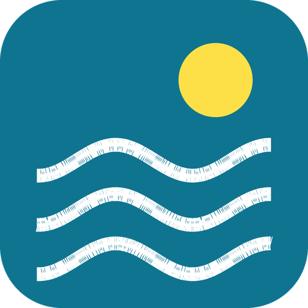

<p align="center">
  
</p>

<h1 align="center">Strand & Zee</h1>

<p align="center">
  Watertemperatuur, golven en wind voor jouw strand of zwemplas in Home Assistant.<br>
  Hoe warm is het water, en is het vandaag de moeite waard?
</p>

<p align="center">
  <a href="https://hacs.xyz"></a>
  <a href="https://github.com/Nickhoog/strand-en-zee/releases"></a>
  
  
  <a href="LICENSE"></a>
</p>

---

## ✨ Wat krijg je?

- 🏖️ **739 officiële zwemlocaties** in een keuzelijst: alle zwemstranden en zwemplassen van provincies en Rijkswaterstaat. Typen om te zoeken werkt.
- 🌡️ **Watertemperatuur** van de zee bij jouw strand.
- 🌊 **Golfhoogte en golfperiode**, handig voor surfers, kitesurfers en SUP'ers.
- 💨 **Windsnelheid en windrichting** (met kompasrichting als `N`, `ZW`, `O`, ...).
- 🔔 Gewone sensoren, dus te gebruiken in automatiseringen, meldingen en dashboards.
- 🇳🇱 Volledig in het **Nederlands** (en Engels), instellen via de UI zonder API-sleutel of account.

> [!NOTE]
> **Modelwaarden, geen metingen.** De waarden komen van [Open-Meteo](https://open-meteo.com/) en zijn berekend
> voor de coördinaten van jouw zwemlocatie. Ze zijn een goede indicatie, maar kunnen afwijken van wat je
> op het strand ziet.

> [!NOTE]
> **Onofficieel.** Deze integratie is niet gemaakt door of verbonden aan Open-Meteo, Rijkswaterstaat of een provincie.

## 📦 Installatie

[](https://my.home-assistant.io/redirect/hacs_repository/?owner=Nickhoog&repository=strand-en-zee&category=integration)

1. Open **HACS** in Home Assistant en zoek **Strand & Zee**, of klik op de knop hierboven.
2. Klik **Download** en **herstart** Home Assistant.
3. Ga naar **Instellingen → Apparaten & diensten → Integratie toevoegen** en kies **Strand & Zee**.

Vereist Home Assistant **2024.8** of nieuwer.

<details>
<summary><b>Alternatief: als custom repository toevoegen</b></summary>

Vind je de integratie niet in HACS?

1. HACS → menu (⋮) → **Custom repositories**.
2. Repository: `https://github.com/Nickhoog/strand-en-zee`, type **Integration** → **Add**.
3. Ga verder bij stap 1 hierboven.

</details>

<details>
<summary><b>Handmatig installeren (zonder HACS)</b></summary>

Kopieer de map `custom_components/strand_en_zee` naar `config/custom_components/` van je
Home Assistant en herstart.

</details>

## ⚙️ Instellen

1. Kies je **zwemlocatie** uit de keuzelijst (bijvoorbeeld *Zandvoort* of *Scheveningen Noorderstrand*).
2. Klaar. Meer stranden? Voeg de integratie gewoon nog een keer toe met een andere locatie.

**Werkt voor** alle 739 officiële zwemlocaties in Nederland, aan de kust en aan binnenwater.

## 🧩 Entities

Per zwemlocatie komt er één apparaat met vijf sensoren:

| Entity | Waarde | Extra informatie |
|---|---|---|
| 🌡️ **Watertemperatuur** | temperatuur in °C | `measured_at` |
| 🌊 **Golfhoogte** | hoogte in m | `measured_at` |
| 〰️ **Golfperiode** | tijd tussen twee golven in s | `measured_at` |
| 💨 **Windsnelheid** | snelheid in m/s (Home Assistant toont evt. km/u) | `measured_at` |
| 🧭 **Windrichting** | richting in graden | `compass` (bijv. `ZW`), `measured_at` |

De gegevens worden elke 15 minuten ververst. Elke sensor toont de bronvermelding van Open-Meteo.

> [!TIP]
> Aan **binnenwater** (plassen en meren) heeft Open-Meteo meestal geen zeedata. Wind werkt daar altijd,
> maar watertemperatuur, golfhoogte en golfperiode zijn dan *niet beschikbaar*. Dat is normaal.

## 💡 Voorbeelden

Vervang `zandvoort` hieronder door de naam van jouw zwemlocatie; de exacte entity-id's vind je onder het apparaat.

### Melding als het water lekker warm is

```yaml
automation:
  - alias: "Zwemweer"
    trigger:
      - platform: numeric_state
        entity_id: sensor.zandvoort_watertemperatuur
        above: 18
    condition:
      - condition: numeric_state
        entity_id: sensor.zandvoort_windsnelheid
        below: 6
    action:
      - service: notify.notify
        data:
          title: "🏊 Zwemweer!"
          message: >
            Het water is {{ states('sensor.zandvoort_watertemperatuur') }} °C
            en er staat weinig wind. Tijd voor een duik.
```

### Dashboardkaart

Een simpele kaart met de strandcondities:

```yaml
type: entities
title: Zandvoort
entities:
  - entity: sensor.zandvoort_watertemperatuur
  - entity: sensor.zandvoort_golfhoogte
  - entity: sensor.zandvoort_golfperiode
  - entity: sensor.zandvoort_windsnelheid
  - type: attribute
    entity: sensor.zandvoort_windrichting
    attribute: compass
    name: Windrichting
```

## ❓ Veelgestelde vragen

<details>
<summary><b>Zijn dit echte metingen?</b></summary>

Nee, het zijn modelwaarden van [Open-Meteo](https://open-meteo.com/), berekend voor de coördinaten van jouw
zwemlocatie. Het golfmodel heeft een raster van enkele kilometers, dus vlak bij de kust kan het een paar
decimeter afwijken van wat je ziet.

</details>

<details>
<summary><b>Waarom heb ik bij mijn zwemplas geen watertemperatuur of golven?</b></summary>

Open-Meteo levert zee- en golfgegevens, geen gegevens van meren en plassen. Voor binnenwater krijg je daarom
alleen wind. De andere sensoren blijven dan *niet beschikbaar*.

</details>

<details>
<summary><b>Mijn zwemlocatie staat niet in de lijst</b></summary>

De lijst bevat de officiële zwemlocaties van provincies en Rijkswaterstaat (de open dataset *Zwemwater*).
Een eigen locatie met coördinaten kan nu niet. Mis je een officiële zwemlocatie?
[Open een issue](https://github.com/Nickhoog/strand-en-zee/issues).

</details>

<details>
<summary><b>Mag ik dit ook commercieel gebruiken?</b></summary>

De gratis Open-Meteo API is bedoeld voor **niet-commercieel** gebruik, zoals persoonlijke domotica, en valt
onder CC BY 4.0. Voor commercieel gebruik heb je zelf een licentie bij Open-Meteo nodig.

</details>

<details>
<summary><b>Wat gebeurt er als Open-Meteo even niet bereikbaar is?</b></summary>

De sensoren worden tijdelijk *niet beschikbaar* en herstellen vanzelf bij de volgende verversing.

</details>

## 🙏 Bronnen

- Weerdata: [Open-Meteo.com](https://open-meteo.com/) (Marine en Forecast API), [CC BY 4.0](https://creativecommons.org/licenses/by/4.0/).
- Zwemlocaties: [PDOK, Zwemwater provinciaal en rijkswateren](https://service.pdok.nl/provincies/zwemwater-provinciaal-rijkswateren/atom/v1_0/index.xml), CC0.

## 🇬🇧 English

Home Assistant integration that gives you the **water temperature, wave height, wave period, wind speed and
wind direction** for any of the 739 official Dutch swimming locations (beaches and lakes). Install it from
**HACS** by searching for *Strand & Zee* (or, as a fallback, add this repository as a custom repository of type
*Integration*), then add the integration and pick your location from the dropdown. The values are model data
from [Open-Meteo](https://open-meteo.com/) (CC BY 4.0, free for non-commercial use only). Inland lakes usually
only get wind. UI translations: Dutch and English.

## 🐞 Fout of idee?

[Open een issue](https://github.com/Nickhoog/strand-en-zee/issues) op GitHub.

## 📄 Licentie

[MIT](LICENSE)
